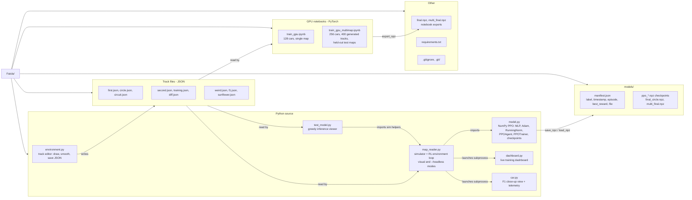
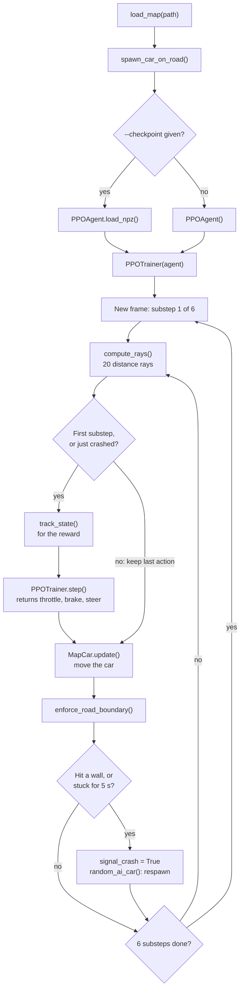
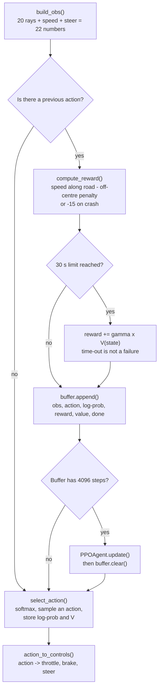
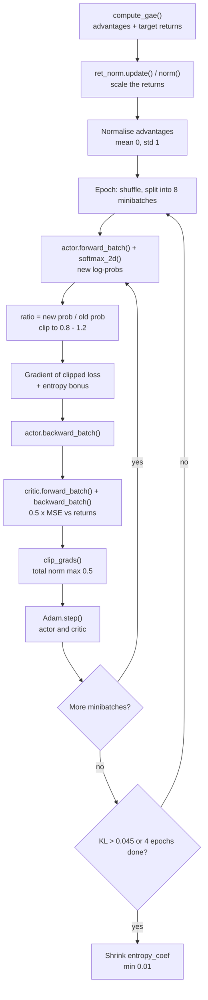

# Faisla — PPO Car Simulator: Architecture

## 1. Folder structure

## 2. How the algorithm works

Three zoom levels. Each box names the real function in the code.

### 2a. The main loop (map_reader.py)

One frame = one decision. Physics runs 6 times per frame; the action is held in between.

### 2b. One decision (model.py, PPOTrainer.step)

### 2c. Learning from the buffer (model.py, PPOAgent.update)

Not shown, to keep the diagrams readable:
- After 30 s, `PPOTrainer.step()` sets `reset_requested`. The main loop then calls `random_ai_car()` and calls `step()` again for the new episode.
- Every 150 episodes the main loop calls `PPOAgent.save_npz()` and moves the car to a new random spawn.
- `PPOAgent.update()` also runs mid-episode if the buffer fills up. It then uses V(current state) as `last_val` in `compute_gae()`.
